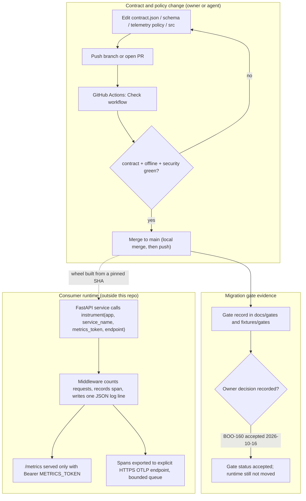
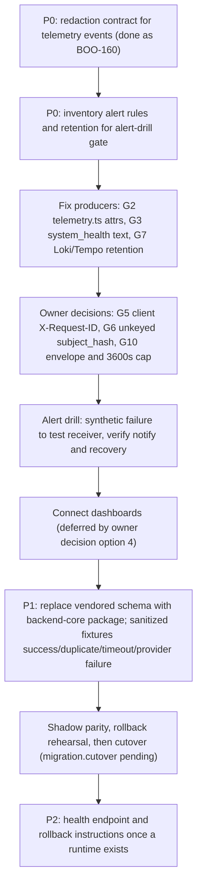

# 01 — Business process (As-Is / To-Be)

repo นี้คือ **library + boundary contract** ของ capability `observability` (logs, metrics, traces, alerts, status) ไม่ใช่ service ที่ host อยู่
`PRODUCT.md` ระบุว่า status เป็น `scaffolded`, DOCPACK verdict `template` และ "No service in production uses it yet"
implementation ปัจจุบันตาม registry คือ `infra/self-hosted-stack` ใน `solo-empire` (ซึ่ง gate doc บันทึกว่าถูกลบออกจาก solo-empire HEAD แล้วใน `9f44f602`, 2026-10-11)

ดังนั้น "business process" ของ repo นี้มี 2 เส้น: (1) การเปลี่ยน contract/policy แล้วให้ CI พิสูจน์ (2) service ที่ใช้ library เรียก `instrument(app, ...)` แล้วผลิต telemetry ที่ถูก redact

## As-Is (จากโค้ดวันนี้)

Sources: `PRODUCT.md`, `README.md`, `contract.json`, `.github/workflows/check.yml`, `docs/gates/BOO-160-telemetry-redaction-retention.md`, `fixtures/gates/telemetry-redaction-retention.json`, `src/platform_observability/middleware.py`, `src/platform_observability/export.py`, `docs/shared-runtime.md`; ops record: merge-locally (2026-11-03)

## To-Be (จากเอกสารใน repo เท่านั้น)

แหล่ง To-Be: `docs/UPGRADE-PLAN.md`, migration gates ใน `contract.json`, "Still open" ใน gate doc และ `docs/shared-runtime.md`

Sources: `docs/UPGRADE-PLAN.md`, `contract.json` (`migration`, `migration_gates`), `docs/gates/BOO-160-telemetry-redaction-retention.md` §Gaps, §Still open, `docs/shared-runtime.md`

## Open questions

- เกณฑ์ cutover สำหรับเปิด runtime (`PRODUCT.md` Measures ติด `[ต้องยืนยัน]`)
- ops record book-platforms-status (2026-11-03) บันทึกว่า "observability = library, decision open" และ scraper จะปลุก service ที่ sleep อยู่: owner ยังไม่ตัดสินว่าจะ host collector/scraper หรือไม่
- implementation เดิม `infra/self-hosted-stack` ไม่อยู่ใน solo-empire HEAD แล้ว แต่ `contract.json` ยังชี้ไปที่ path นั้น: จะแก้ `current_implementation` อย่างไร
