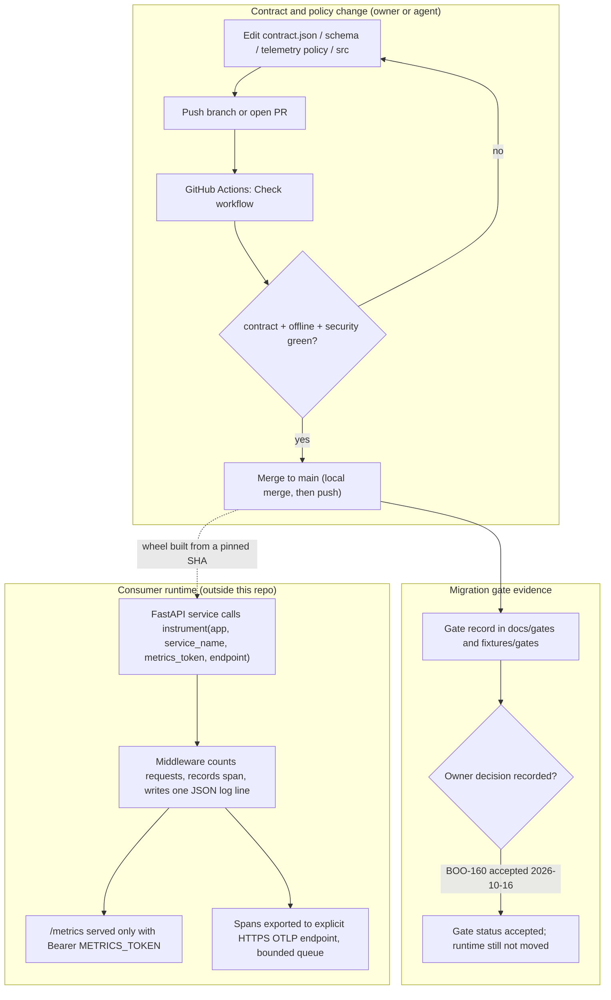
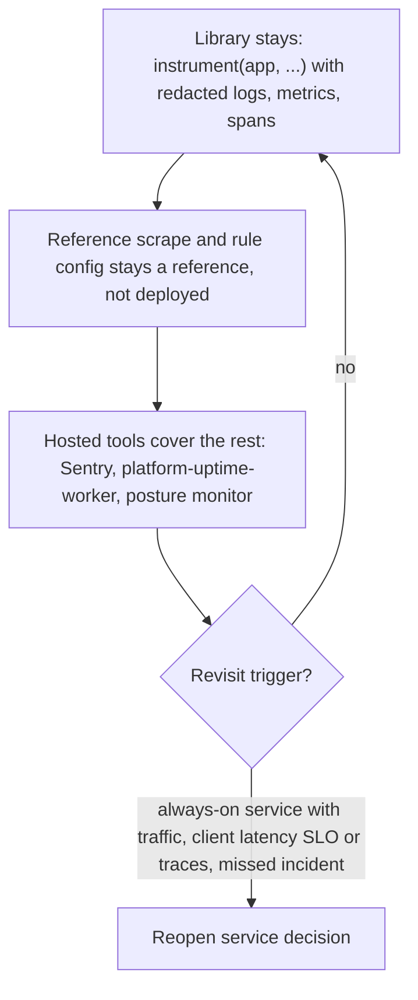

# 01 — Business process (As-Is / To-Be)

repo นี้คือ **library + boundary contract** ของ capability `observability` (logs, metrics, traces, alerts, status) ไม่ใช่ service ที่ host อยู่
`PRODUCT.md` ระบุว่า status เป็น `scaffolded`, DOCPACK verdict `template` และ "No service in production uses it yet"
implementation ปัจจุบันตาม registry คือ `infra/self-hosted-stack` ใน `solo-empire` (ซึ่ง gate doc บันทึกว่าถูกลบออกจาก solo-empire HEAD แล้วใน `9f44f602`, 2026-10-11)

ตามการตัดสินใจของ owner 2026-11-04 repo นี้คงเป็น library พร้อม config อ้างอิง ไม่มี service/collector/scraper ที่ deploy (`docs/DECISION-2026-11-04-library-not-service.md`)

ดังนั้น "business process" ของ repo นี้มี 2 เส้น: (1) การเปลี่ยน contract/policy แล้วให้ CI พิสูจน์ (2) service ที่ใช้ library เรียก `instrument(app, ...)` แล้วผลิต telemetry ที่ถูก redact

Last reviewed: 2026-11-27 · commit `7bfc24d`

## As-Is (จากโค้ดวันนี้)

Sources: `PRODUCT.md`, `README.md`, `contract.json`, `.github/workflows/check.yml`, `docs/gates/BOO-160-telemetry-redaction-retention.md`, `fixtures/gates/telemetry-redaction-retention.json`, `src/platform_observability/middleware.py`, `src/platform_observability/export.py`, `docs/shared-runtime.md`; ops record: merge-locally (2026-11-03)

## To-Be (จาก decision 2026-11-04, `docs/UPGRADE-PLAN.md` และ gate BOO-160)

To-Be ที่เขียนไว้คือ library + reference config ไม่มี observability service (owner ตัดสิน 2026-11-04) การ cutover/shadow parity/alert drill ใน `contract.json` และ `UPGRADE-PLAN.md` ที่เขียนไว้ก่อนหน้านั้นสันนิษฐานว่ามี runtime จึงถูกแทนที่ด้วยการตัดสินใจนี้ [ต้องยืนยัน] ว่า owner ต้องการปิดรายการเหล่านั้นอย่างเป็นทางการ

Sources: `docs/DECISION-2026-11-04-library-not-service.md`, `docs/gates/BOO-160-telemetry-redaction-retention.md` §Still open, `docs/UPGRADE-PLAN.md`, `docs/shared-runtime.md`

## Gap

| ID | As-Is → To-Be | Status | Owner | Evidence |
|---|---|---|---|---|
| G1 | redaction contract ไม่มี → contract + fixtures สำหรับ telemetry event | done | claude | `docs/gates/BOO-160-telemetry-redaction-retention.md`, `fixtures/gates/telemetry-redaction-retention.json` |
| G2 | registry/contract ยังมี migration cutover pending และชี้ `infra/self-hosted-stack` → ตรงกับ decision library-only | decide | owner | `contract.json` `current_implementation`, `migration`; `docs/DECISION-2026-11-04-library-not-service.md` (registry คง `local-scaffold`) |
| G3 | producers ปล่อยข้อมูลที่ยังไม่ผ่าน gate (telemetry.ts attrs, system_health text, Loki/Tempo retention) → แก้ก่อนต่อ dashboard | decide | owner | `docs/gates/BOO-160-telemetry-redaction-retention.md` §Still open (G2, G3, G7; dashboard ถูก defer) |
| G4 | owner decisions ค้าง (client X-Request-ID, unkeyed subject_hash, envelope และ cap 3600 s) | decide | owner | `docs/gates/BOO-160-telemetry-redaction-retention.md` §Still open (G5, G6, G10) |
| G5 | schema vendored → package จาก backend-core, sanitized fixtures success/duplicate/timeout/failure | todo | claude | `docs/UPGRADE-PLAN.md` P1 |
| G6 | ไม่มี health endpoint/rollback doc → เมื่อมี runtime | blocked | claude | `docs/UPGRADE-PLAN.md` P2; ไม่มี runtime ตาม decision 2026-11-04 |

## Open questions

- เกณฑ์ cutover สำหรับเปิด runtime (`PRODUCT.md` Measures ติด `[ต้องยืนยัน]`)
- implementation เดิม `infra/self-hosted-stack` ไม่อยู่ใน solo-empire HEAD แล้ว แต่ `contract.json` ยังชี้ไปที่ path นั้น: จะแก้ `current_implementation` อย่างไร (G2)
