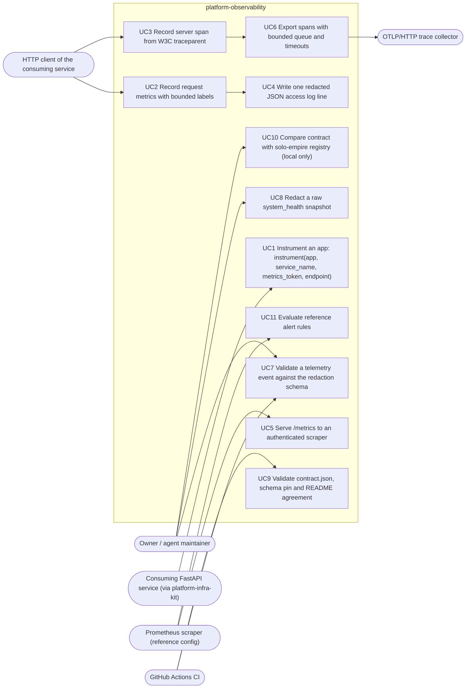

# 02 — Use cases

Actors คือผู้ที่เรียกใช้ library หรือ contract จริง: ไม่มี end user และไม่มี auth level แบบ role ในโค้ด
auth เดียวใน runtime คือ Bearer `METRICS_TOKEN` ที่ `/metrics` (`middleware.py`)

| Actor | ระดับการเข้าถึงในโค้ด | หลักฐาน |
|---|---|---|
| Consuming service | เรียก `instrument()` ได้ครั้งเดียวต่อ app (`telemetry already configured`) | `src/platform_observability/middleware.py` |
| Prometheus scraper | ต้องส่ง `Authorization: Bearer <METRICS_TOKEN>`; ไม่มี token = `/metrics` 404, ผิด = 401 | `middleware.py`, `config/prometheus.yaml` |
| HTTP client | ไม่รู้ว่าถูก instrument; ส่ง `traceparent`/`tracestate` ได้ (≤512 bytes) | `middleware.py` |
| OTLP collector | รับ POST protobuf; ต้องเป็น HTTPS ยกเว้น loopback | `middleware.py`, `export.py` |
| Owner / CI | รัน `scripts/*.py` และ `bash scripts/check.sh` | `scripts/`, `.github/workflows/check.yml` |

Sources: `src/platform_observability/middleware.py`, `src/platform_observability/export.py`, `config/prometheus.yaml`, `config/shared-alerts.yaml`, `scripts/telemetry_policy.py`, `scripts/check.py`, `scripts/check_registry_alignment.py`, `docs/shared-runtime.md`

## Open questions

- consumer จริงใน production: ไม่พบ `platform_observability` import ใน platform-* repo อื่น (ค้นใน worktree ของ Core 22 batch) และ `PRODUCT.md` บอกว่ายังไม่มี service ใช้: ใครจะเป็น consumer แรก
