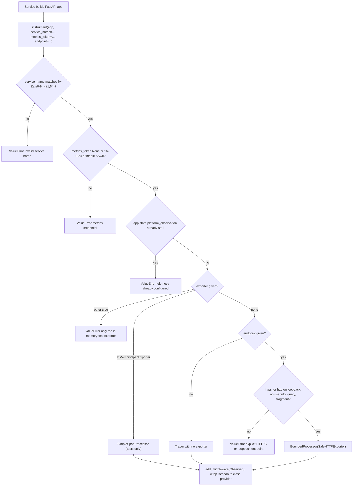
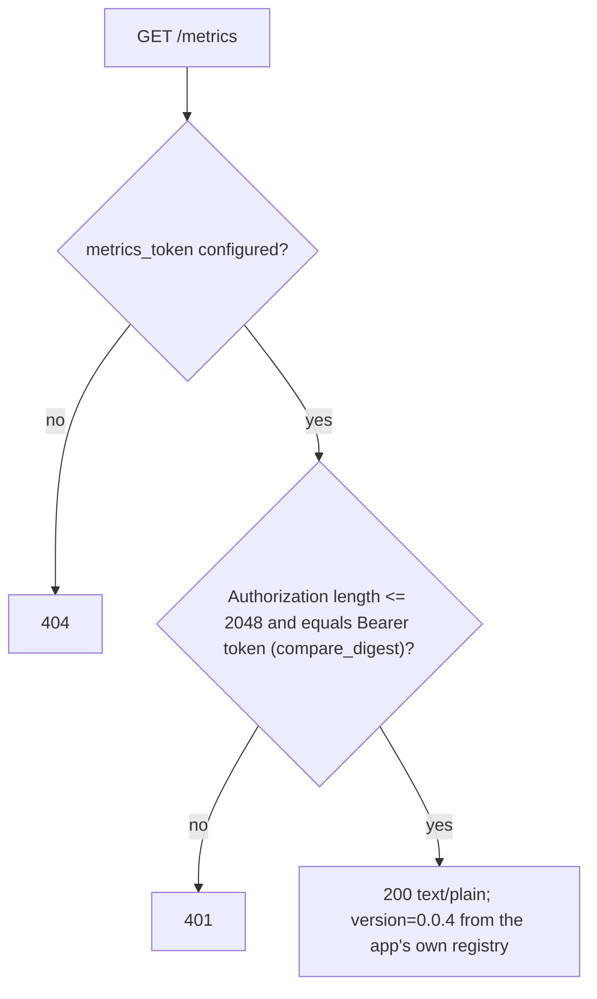
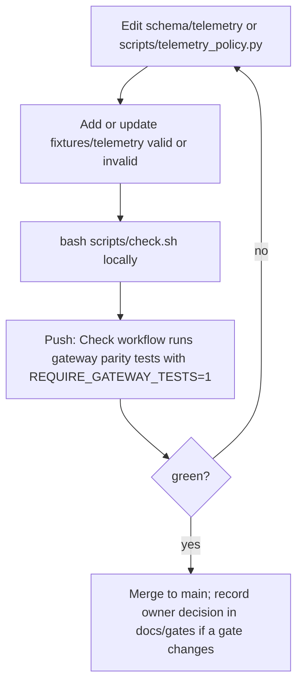

# 03 — User flows

ไม่มี UI หรือ route ของตัวเอง flow หลักคือ flow ของ "ผู้ใช้" แต่ละประเภทตาม `02-use-cases.md`

## Flow A — Consuming service ติดตั้ง instrumentation

## Flow B — Scraper อ่าน /metrics

## Flow C — Maintainer เปลี่ยน telemetry policy

Sources: `src/platform_observability/middleware.py`, `docs/shared-runtime.md`, `scripts/check.sh`, `.github/workflows/check.yml`, `docs/gates/BOO-160-telemetry-redaction-retention.md` §Verification

## Open questions

- ไม่มี
