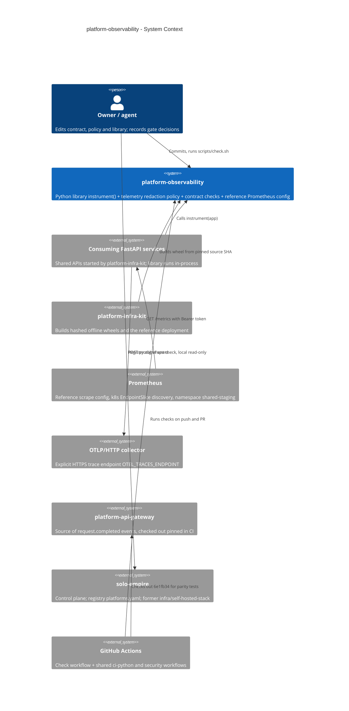

# 05 — C4 Context

library นี้ไม่ได้รันเอง ภาพ context จึงวาง library ไว้ "ภายใน" service ที่ใช้มัน และแสดงระบบรอบข้างที่ config อ้างถึง

Sources: `README.md`, `PRODUCT.md`, `contract.json`, `docs/shared-runtime.md`, `config/prometheus.yaml`, `.github/workflows/check.yml`, `scripts/check_registry_alignment.py`; architecture-docs [`docs/superpowers/specs/2026-10-15-shared-infrastructure-design.md`](https://github.com/bookchaowalit/architecture-docs/blob/main/docs/superpowers/specs/2026-10-15-shared-infrastructure-design.md) (capability owners table)

## Open questions

- ไม่มี collector, Prometheus หรือ Grafana ที่ host จริงที่ยืนยันได้จาก repo: ระบบภายนอกในภาพเป็น "reference/staging" ตาม `docs/shared-runtime.md`
