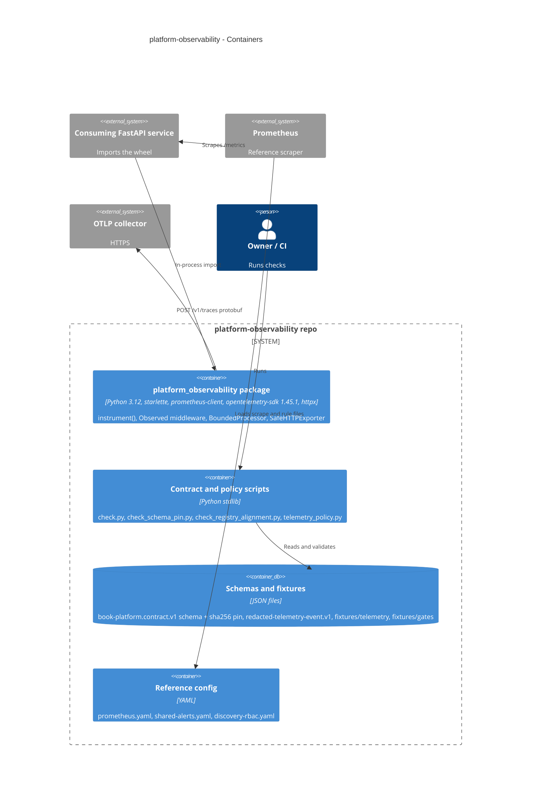

# 06 — C4 Container

"container" ของ library คือหน่วยที่ส่งมอบแยกกัน: Python package, CLI scripts, schema/fixtures และ reference config

Sources: `pyproject.toml`, `src/platform_observability/__init__.py`, `src/platform_observability/middleware.py`, `src/platform_observability/export.py`, `scripts/*.py`, `schema/`, `fixtures/`, `config/*.yaml`

## Open questions

- ไม่มี
