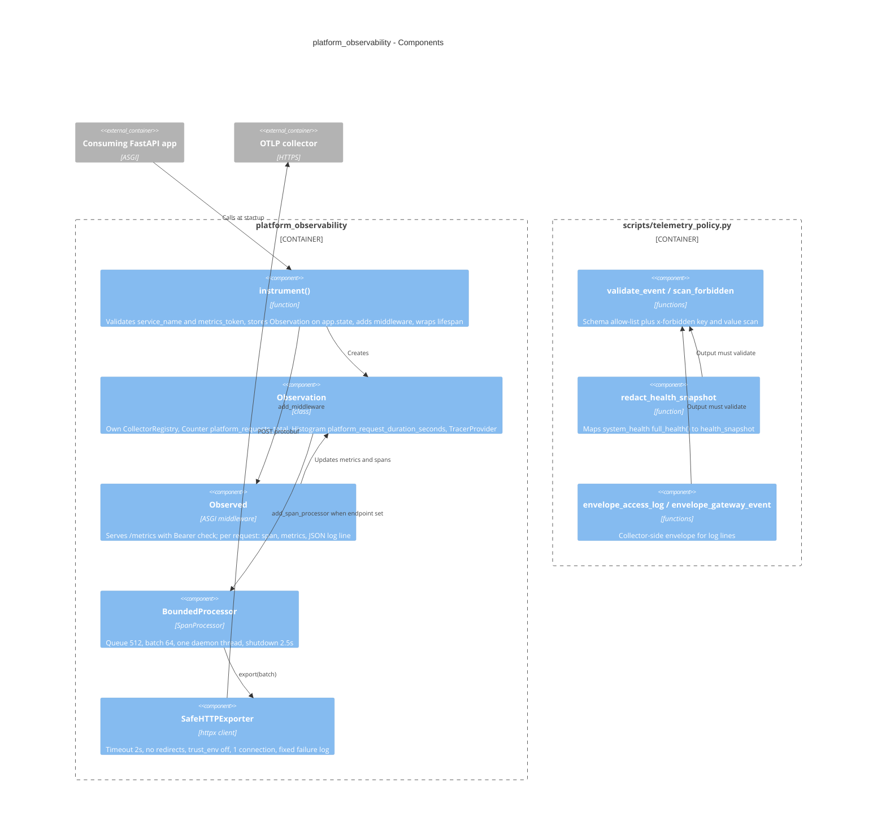

# 07 — C4 Component

ส่วนประกอบภายใน package `platform_observability` และ policy script

Sources: `src/platform_observability/middleware.py`, `src/platform_observability/export.py`, `scripts/telemetry_policy.py`

## Open questions

- ไม่มี
