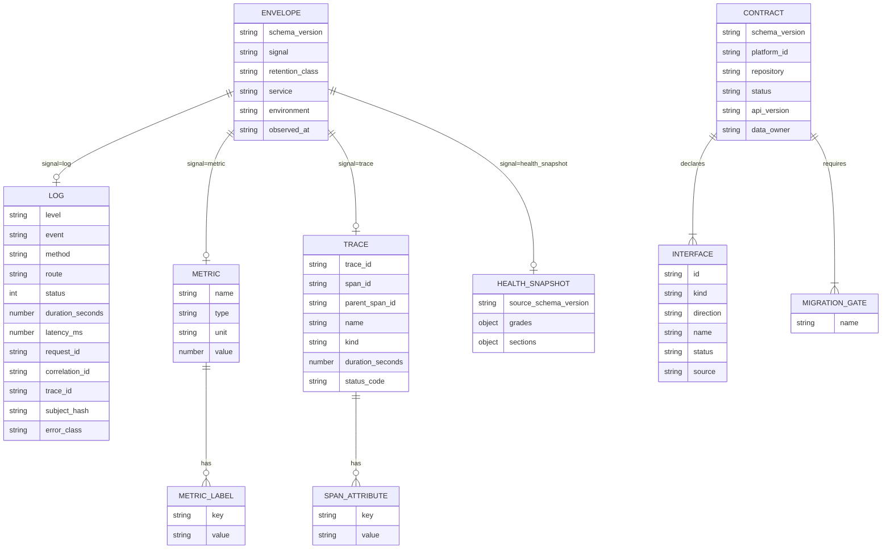

# 09 — ERD

library **ไม่มี database และไม่ persist ข้อมูล** (metrics อยู่ใน `CollectorRegistry` ในหน่วยความจำของ process, spans อยู่ใน queue ที่ทิ้งเมื่อ shutdown) แต่ repo กำหนด data model ที่ตรวจได้ใน JSON Schema ภาพนี้จึงเป็น logical model ของ telemetry event (`redacted-telemetry-event.v1`) และ boundary contract

| Signal | `retention_class` | Store ที่วางแผน | Retention (accepted) |
|---|---|---|---|
| metric | `metric-30d` | Prometheus TSDB | 30 วัน |
| log | `log-14d` | Loki | 14 วัน |
| trace | `trace-7d` | Tempo | 7 วัน |
| health_snapshot | `health-90d` | file/object store | 90 วัน |

Runtime in-memory metric series ที่ library สร้าง: `platform_requests_total{service,method,route,status}` และ `platform_request_duration_seconds{service,method,route}` (buckets .005–10 s)

Sources: `schema/telemetry/redacted-telemetry-event.v1.schema.json`, `contract.json`, `schema/book-platform.contract.v1.schema.json`, `docs/gates/BOO-160-telemetry-redaction-retention.md` §Retention policy, `src/platform_observability/middleware.py`

## Open questions

- store จริงของ metric/log/trace/health ยังไม่มี (retention ยังไม่ถูก apply) ตาม gate doc
