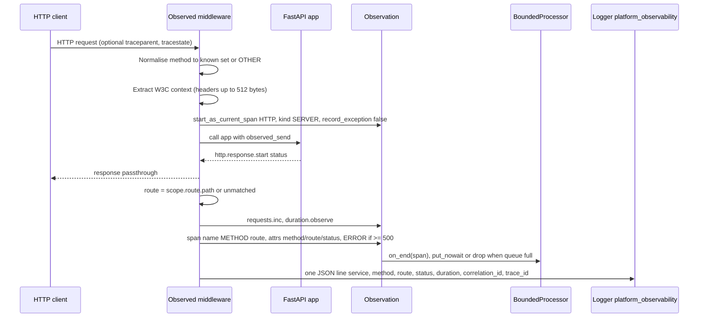
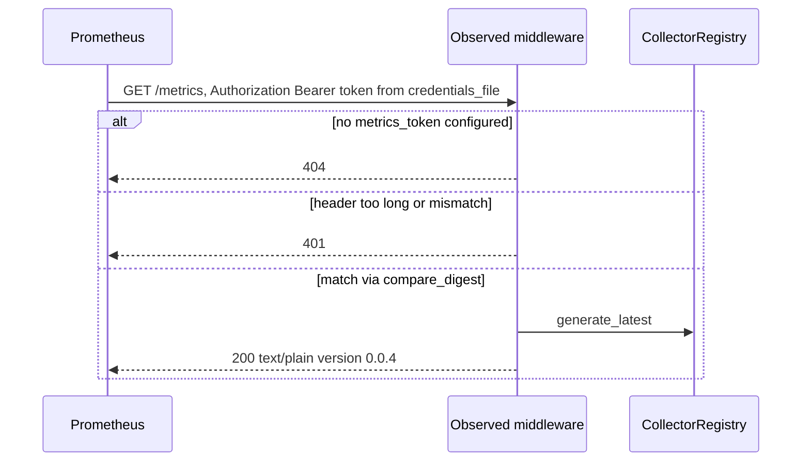
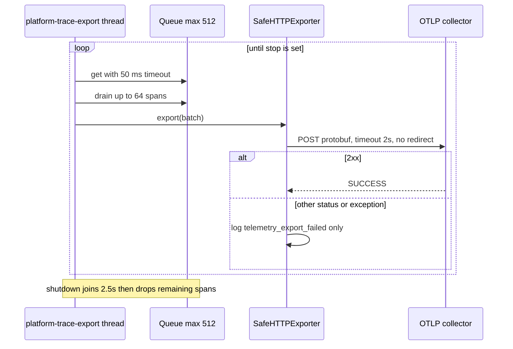
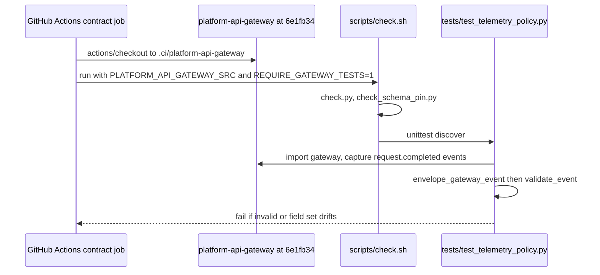

# 10 — Sequences

## S1 — Request ผ่าน instrumented service

## S2 — Prometheus scrape

## S3 — Span export

## S4 — CI gateway parity check

Sources: `src/platform_observability/middleware.py`, `src/platform_observability/export.py`, `config/prometheus.yaml`, `.github/workflows/check.yml`, `scripts/check.sh`, `tests/test_telemetry_policy.py` (`GatewayTelemetryTests`)

## Open questions

- ไม่มี
