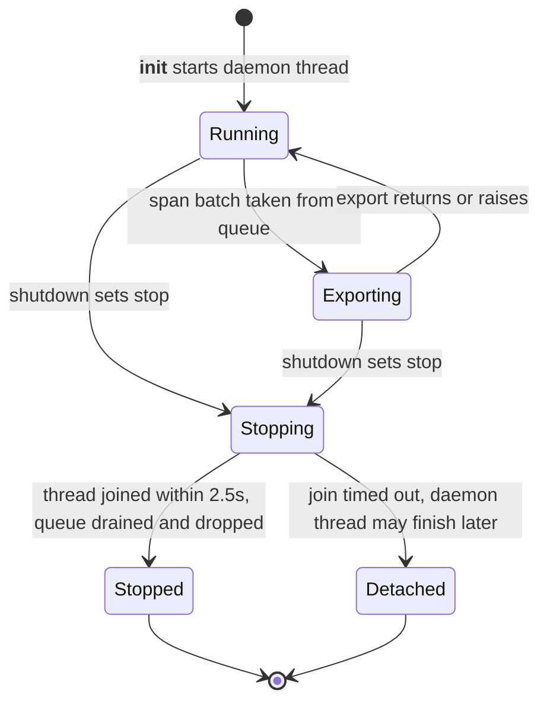
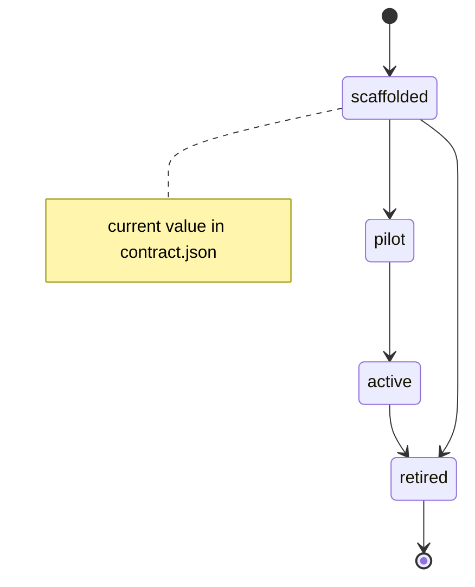
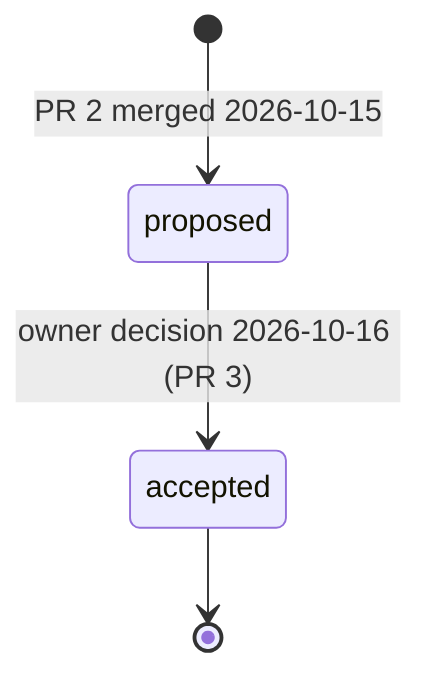

# 11 — State machines

ไม่มี entity ที่มี status field ใน database มี lifecycle จริงสองแบบ: export processor ใน runtime และสถานะ contract/migration ใน `contract.json`

## BoundedProcessor lifecycle

`on_end` ไม่รับ span เมื่อ stop ถูก set หรือ span ไม่ sampled และทิ้ง span เมื่อ queue เต็ม

## Contract status (schema enum)

ลำดับการเปลี่ยนเป็นการตีความจากความหมายของ enum (`scaffolded`, `pilot`, `active`, `retired`) schema ไม่ได้บังคับ transition

## Gate decision (BOO-160)

Sources: `src/platform_observability/export.py`, `contract.json`, `schema/book-platform.contract.v1.schema.json` (`status` enum), `docs/gates/BOO-160-telemetry-redaction-retention.md`, `fixtures/gates/telemetry-redaction-retention.json` (`status`)

## Open questions

- ลำดับ transition ของ contract status ไม่ได้เขียนไว้ใน repo
