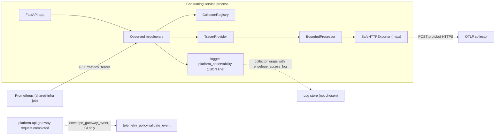

# 12 — API & integrations

## Endpoints และ interfaces

| Interface | Kind | ใครให้ | Auth | พฤติกรรม | แหล่ง |
|---|---|---|---|---|---|
| `GET /metrics` (ใน service ที่ instrument) | http | library | Bearer `METRICS_TOKEN` (compare_digest, header ≤ 2048) | 404 เมื่อไม่ตั้ง token, 401 เมื่อผิด, 200 Prometheus text | `middleware.py` |
| ทุก HTTP route ของ consumer | http | consumer | ของ consumer | ถูกนับ metric, สร้าง span, เขียน log หนึ่งบรรทัด | `middleware.py` |
| `POST <OTEL_TRACES_ENDPOINT>` | event (OTLP/HTTP protobuf) | library ส่งออก | ไม่มี header auth ในโค้ด | 2xx = success; อื่น ๆ = failure ไม่ retry | `export.py` |
| `instrument(app, *, service_name, metrics_token, exporter, endpoint)` | Python API | library | - | ดู `03-user-flows.md` Flow A | `middleware.py` |
| `telemetry_policy.py validate EVENT.json ...` | CLI | repo | - | exit 1 เมื่อมี event ไม่ผ่าน | `scripts/telemetry_policy.py` |
| `telemetry_policy.py redact-health [--assume-tz ZONE] RAW.json` | CLI | repo | - | พิมพ์ health_snapshot ที่ redact แล้ว | `scripts/telemetry_policy.py` |
| `check.py`, `check_schema_pin.py [--canonical PATH]`, `check_registry_alignment.py --solo-empire PATH` | CLI | repo | - | exit non-zero เมื่อ drift | `scripts/` |

## Compatibility surface ที่ contract ระบุ (ให้บริการโดย solo-empire ไม่ใช่ repo นี้)

| ID | Direction | Interface | Status |
|---|---|---|---|
| `observability.event.otlp-traces` | consumes | OTLP/HTTP traces to `http://localhost:4318/v1/traces` (Tempo), opt-in `OTEL_ENABLED=true` | current-in-solo-empire |
| `observability.http.api-health` | consumes | `GET /health` on solo-empire-api | current-in-solo-empire |
| `observability.config.compose-profile` | provides | docker compose profile `observability` | current-in-solo-empire |

ดูรายละเอียดเต็มที่ [`docs/CONTRACT-SURFACE.md`](../CONTRACT-SURFACE.md) (reused)

## Integration flow

Sources: `src/platform_observability/middleware.py`, `src/platform_observability/export.py`, `scripts/telemetry_policy.py`, `scripts/check*.py`, `contract.json`, `docs/CONTRACT-SURFACE.md`, `config/prometheus.yaml`, `docs/shared-runtime.md`

## Open questions

- collector ปลายทางจะใช้ auth แบบใด: `SafeHTTPExporter` ไม่ส่ง header auth เลย
- log store ปลายทางของ JSON access log ยังไม่ถูกเลือก (gate doc ระบุ Loki เป็น store ของ `log-14d` แต่ไม่มี config ใน repo)
