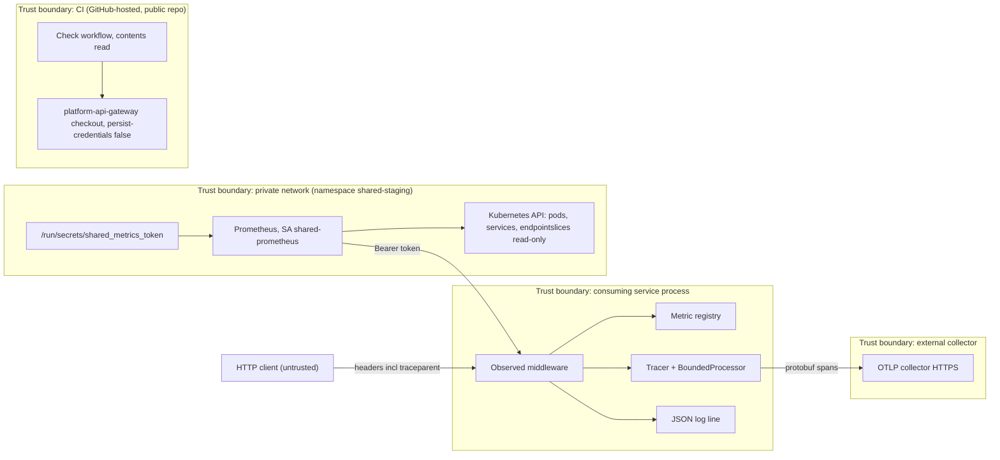

# 13 — Threat model

## DFD และ trust boundaries

## STRIDE

| Element | S | T | R | I | D | E | Mitigations ในโค้ด | Gaps |
|---|---|---|---|---|---|---|---|---|
| `/metrics` endpoint | scraper ปลอม | - | - | metric labels รั่ว ID | scrape ถี่ | - | Bearer + `secrets.compare_digest`, header ≤ 2048, ไม่มี token = 404; labels จำกัด route template / method set; `/metrics` ไม่ถูกนับเอง | token เดียวใช้ร่วมทุก service (`docs/shared-runtime.md`); ไม่มี rate limit; ต้องพึ่ง network policy |
| Middleware (request path) | traceparent ปลอม | - | log ไม่มี subject | URL, query, header, body, exception text | header ใหญ่ | - | carrier รับเฉพาะ `traceparent`/`tracestate` ≤ 512; `record_exception=False`; route ต้องตรง `_ROUTE` ไม่งั้น `unmatched`; log มีเฉพาะ field คงที่ | client ควบคุม trace id ได้ (link กับ trace ภายนอก) |
| BoundedProcessor / exporter | collector ปลอม | span ถูกแก้ระหว่างทาง | - | response/exception text ใน diagnostics | collector ช้า/ล่ม | - | HTTPS บังคับ (ยกเว้น loopback), system trust store, no redirect, `trust_env=False`, timeout 2 s, queue 512, shutdown 2.5 s, fixed log message | ไม่มี auth ไป collector; span หายเมื่อ queue เต็ม (ตั้งใจ) |
| Prometheus + RBAC | - | - | - | - | - | SA อ่าน cluster | Role namespace-scoped `get/list/watch` pods, services, endpointslices; pods ไม่มี SA token (`docs/shared-runtime.md`) | config เป็น reference ยังไม่ถูก deploy/ทดสอบกับ binary จริง |
| Telemetry policy | - | fixture ถูกแก้ให้ผ่าน | - | PII/secret ใน event | - | - | allow-list `additionalProperties: false`, `x-forbidden` keys/patterns, tests ครบทุก pattern | G5 client request ID, G6 unkeyed `subject_hash`, G10 envelope (gate doc) |
| CI | action ถูกแทน | supply chain | - | secret ใน log | - | token เขียน repo | `permissions: contents: read`, actions pin SHA + test, gateway checkout `persist-credentials: false`, gitleaks/semgrep/osv/trivy | `.gitleaksignore` ยกเว้น synthetic fixtures (ตั้งใจ) |

Sources: `src/platform_observability/middleware.py`, `src/platform_observability/export.py`, `config/prometheus.yaml`, `config/discovery-rbac.yaml`, `docs/shared-runtime.md`, `schema/telemetry/redacted-telemetry-event.v1.schema.json`, `docs/gates/BOO-160-telemetry-redaction-retention.md` §Gaps, `.github/workflows/check.yml`, `.gitleaksignore`, `tests/test_build_hygiene.py`

## Open questions

- collector auth และ network policy สำหรับ `/metrics` ยังไม่มีใน repo
- G5, G6, G10 รอ owner decision
