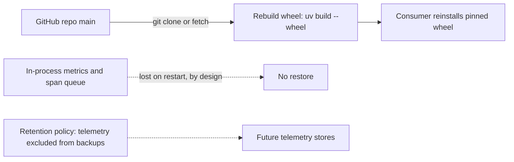

# 14 — Backup & DR

| ข้อมูล | อยู่ที่ไหน | Backup / restore จริง | RTO / RPO |
|---|---|---|---|
| Source, schemas, fixtures, gate records | Git (`github.com/bookchaowalit-backend/platform-observability`) + local clones | ประวัติ Git เป็น backup โดยธรรมชาติ ไม่มี workflow backup แยก | not defined |
| Metric series | in-memory `CollectorRegistry` ของแต่ละ consumer process | ไม่มี: หายเมื่อ process restart (ออกแบบไว้) | not defined |
| Spans ใน queue | in-memory queue ≤ 512 | ไม่มี: ทิ้งตอน shutdown (`docs/shared-runtime.md`) | not defined |
| Telemetry stores (Prometheus/Loki/Tempo/health) | ยังไม่มีที่ host | นโยบายที่ accepted: **ไม่เก็บ telemetry ใน backup**, purge ≤ 24 h หลังหมดอายุ | not defined |

DR ของ runtime อยู่ที่ consumer: shared-infra verification report บันทึกว่า restore drill (pg_dump/pg_restore) อยู่ใน platform-infra-kit ไม่ใช่ repo นี้ (`docs/shared-runtime.md`: "The real multi-process HTTP acceptance and restore drill live in `platform-infra-kit`")

Sources: `src/platform_observability/middleware.py`, `src/platform_observability/export.py`, `docs/shared-runtime.md`, `docs/gates/BOO-160-telemetry-redaction-retention.md` §Retention policy, `.github/workflows/check.yml`; architecture-docs [`docs/superpowers/reports/2026-10-15-shared-infrastructure-verification.md`](https://github.com/bookchaowalit/architecture-docs/blob/main/docs/superpowers/reports/2026-10-15-shared-infrastructure-verification.md)

## Open questions

- RTO/RPO ไม่ได้กำหนด (และไม่มี store ให้กำหนด) จนกว่าจะเลือก telemetry store
