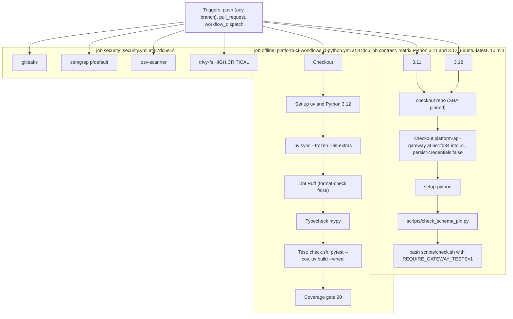

# 15 — CI/CD pipeline

workflow เดียว `.github/workflows/check.yml` (name `Check`) มีสาม job ที่ไม่มี `needs` ต่อกัน (รันขนาน) ไม่มีขั้น deploy
concurrency `check-${{ github.ref }}` cancel-in-progress, `permissions: contents: read`

ประวัติ: workflow `Shared runtime` (มาจาก PR #1) รันครั้งสุดท้าย 2026-10-23 แล้วถูกรวมเข้า job `offline` (comment ใน `check.yml`: "formerly shared-runtime.yml")

Sources: `.github/workflows/check.yml`, `scripts/check.sh`, `pyproject.toml`; `bookchaowalit/platform-ci-workflows` `.github/workflows/ci-python.yml` และ `security.yml` ที่ `87dc5e1` (local clone, read-only); `gh run list -R bookchaowalit-backend/platform-observability -L 100`

## Open questions

- ไม่มี
