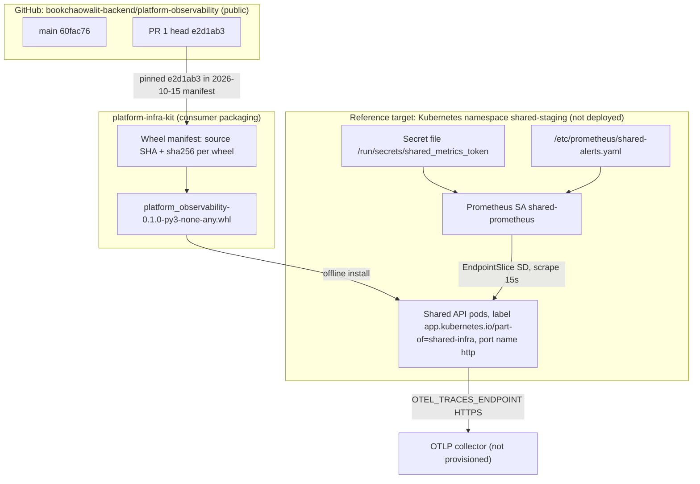

# 16 — Deployment

repo นี้ **ไม่มี hosted runtime** (ไม่มี Dockerfile, Railway, Vercel หรือ Worker config; `tests/test_build_hygiene.py` ยืนยันว่าไม่มี Dockerfile) "deployment" คือการที่ consumer ติดตั้ง wheel ที่ pin ตาม source SHA และ reference config สำหรับ Kubernetes staging

| สิ่งที่ consumer ตั้งค่า | ที่มา |
|---|---|
| `METRICS_TOKEN` (ใส่เป็น `metrics_token`) | `docs/shared-runtime.md` |
| `OTEL_TRACES_ENDPOINT` (ใส่เป็น `endpoint`) | `docs/shared-runtime.md` |
| Python ≥ 3.12, deps pinned (`opentelemetry-*==1.45.1`) | `pyproject.toml`, `uv.lock` |

Sources: `pyproject.toml`, `uv.lock`, `config/prometheus.yaml`, `config/shared-alerts.yaml`, `config/discovery-rbac.yaml`, `docs/shared-runtime.md`, `tests/test_build_hygiene.py`; architecture-docs [`docs/superpowers/reports/2026-10-15-shared-infrastructure-wheels.json`](https://github.com/bookchaowalit/architecture-docs/blob/main/docs/superpowers/reports/2026-10-15-shared-infrastructure-wheels.json); ops record: book-platforms-status (2026-11-03) "observability is a library (no service)"

## Open questions

- wheel manifest ล่าสุดที่อ่านได้ pin `e2d1ab3` (head ของ PR #1 ก่อน merge) ไม่ใช่ main ปัจจุบัน: มี manifest ใหม่ที่ pin main หรือไม่
- 8 platform services ที่ live บน Railway ไม่ได้ import library นี้ (ค้นใน worktree Core 22 ไม่พบ): จะใช้ library กับ Railway services หรือคงไว้เป็น reference k8s เท่านั้น
