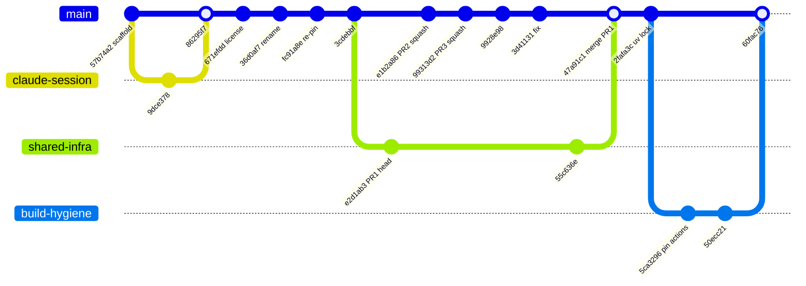
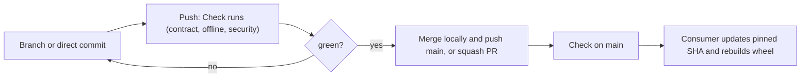

# 18 — Git & release workflow

ทาง merge ที่เห็นใน history: PR squash บน GitHub (#2, #3), merge commit แบบ local แล้ว push (PR #1 → `47a91c1` และ gh แสดง PR #1 เป็น CLOSED ไม่ใช่ MERGED; `build-hygiene` → `60fac76`) และ commit ตรงบน main
ไม่มี tag, ไม่มี release และไม่มี deploy: "release" คือ commit บน main ที่ Check เขียว ซึ่ง consumer ต้อง pin SHA เอง

Sources: `git log --first-parent --format="%h %ad %p %s" origin/main`, `gh pr list -R bookchaowalit-backend/platform-observability --state all`, `gh run list -R bookchaowalit-backend/platform-observability -L 100`, `.github/workflows/check.yml`; ops record: merge-locally (2026-11-03)

## Open questions

- ไม่มี branch protection หรือ required checks ที่อ่านได้จาก repo: main รับ direct push (เช่น `4a03324` ที่ Check แดง)
