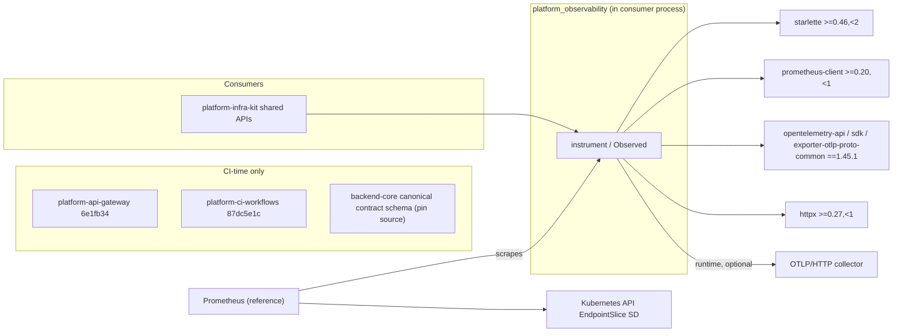

# 19 — Service dependency map

`contract.json` `depends_on: []`: ไม่พึ่ง platform อื่นใน runtime dependency ที่มีคือ library ภาษา Python และระบบภายนอกที่ consumer ต้องจัดให้

Sources: `contract.json`, `pyproject.toml`, `uv.lock`, `src/platform_observability/*.py`, `config/prometheus.yaml`, `.github/workflows/check.yml`, `scripts/check_schema_pin.py`, `docs/shared-runtime.md`

## Open questions

- ไม่มี
