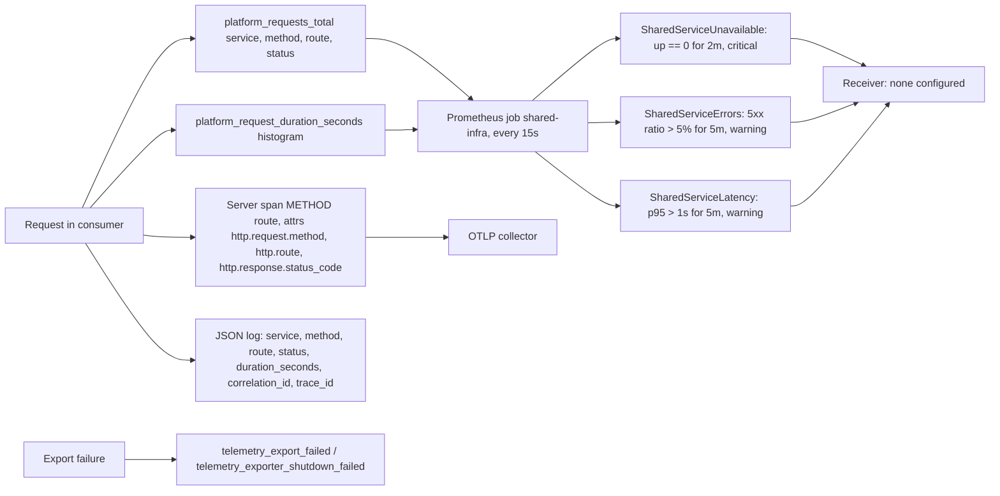
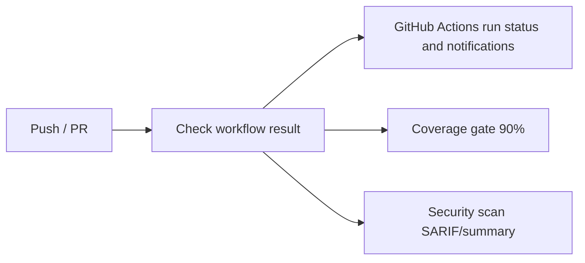

# 20 — Observability

repo นี้ **ผลิต** observability ให้คนอื่น แต่ไม่มี runtime ของตัวเองจึงไม่มี Sentry (waiver ใน `PRODUCT.md`: "nothing is built into an image or deployed from this repository") ภาพแรกคือ signal ที่ library ปล่อยจริงและสิ่งที่ reference config เฝ้าดู ภาพที่สองคือสัญญาณของ repo เอง

## Signals ที่ library ผลิต

## Signals ของ repo เอง

ไม่มี uptime target, heartbeat หรือ PostHog สำหรับ repo นี้ (ไม่มี URL); ops record book-platforms-status (2026-11-03) บันทึก Sentry/uptime สำหรับ 8 platform services ที่ live แต่ไม่รวม observability

Sources: `src/platform_observability/middleware.py`, `src/platform_observability/export.py`, `config/prometheus.yaml`, `config/shared-alerts.yaml`, `docs/shared-runtime.md`, `PRODUCT.md`, `.github/workflows/check.yml`

## Open questions

- thresholds ใน `shared-alerts.yaml` เป็น "staging drill thresholds, not a promised service level": SLO จริงคืออะไร
- dashboards ถูก defer โดย owner decision BOO-160 option 4
