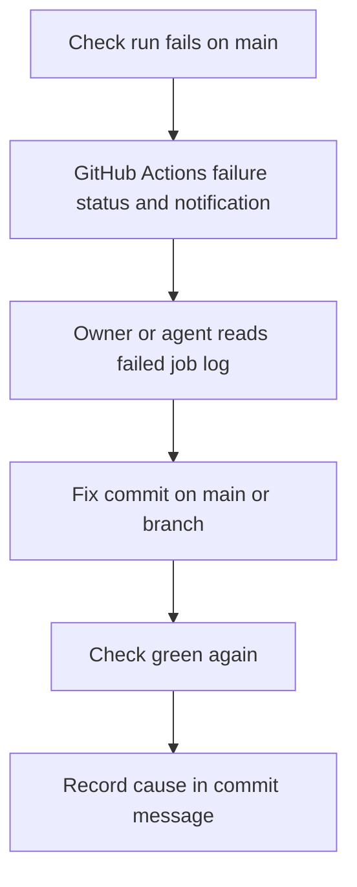
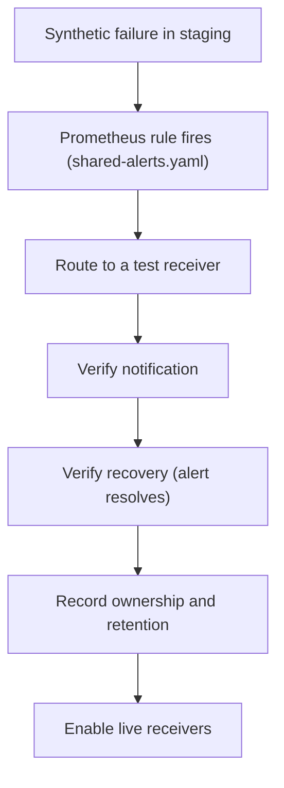

# 21 — Incident response

repo นี้ไม่มี runtime จึงไม่มี on-call ของตัวเอง alert rules มีเฉพาะใน reference config และ **ไม่มี receiver** (`docs/shared-runtime.md`: "This change sends no notifications") ภาพด้านล่างแยก flow ที่เกิดจริงวันนี้ (CI แดง) กับ flow ที่ออกแบบไว้สำหรับ alert drill

## Flow ที่เกิดจริง: CI failure บน main

ตัวอย่างจริง: `4a03324` แดง 2026-10-22 09:41Z → `3d41131` "fix: mark the shebang scripts executable (Ruff EXE001)" เขียว 09:44Z

## Flow ที่ออกแบบไว้: alert drill (ยังไม่ทำ)

Sources: `config/shared-alerts.yaml`, `docs/shared-runtime.md`, `contract.json` (`migration_gates: alert drill`), `docs/gates/BOO-160-telemetry-redaction-retention.md` G8, `gh run list -R bookchaowalit-backend/platform-observability -L 100`, `git log origin/main`

## Open questions

- receiver จริง (Telegram, email ฯลฯ) และเจ้าของ alert ยังไม่กำหนด
- Alertmanager notification history retention (G8) ยังไม่ตัดสิน
- ไม่มี postmortem template ใน repo
